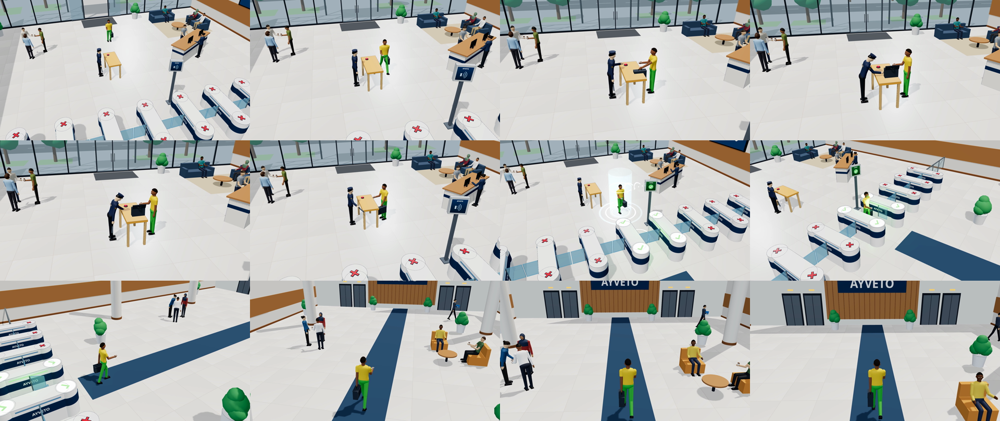

# AYVETO Access Process – 3D Animation

**Video:** [`ayveto_access_process.mp4`](ayveto_access_process.mp4) — 24 s, 1920×1080 (16:9), 30 fps, H.264, no audio.

The video shows the AYVETO company access flow: the visitor arrives with their own ID card → the security guard inspects their bag → the visitor walks toward the AYVETO gate → the RFID card is detected automatically from a distance (no tap) → a green indicator shows success and the gate opens **before the visitor arrives** → the visitor walks straight through without stopping, into the company, and the gate closes behind them.

Both characters have realistic human proportions (about 1.78 m tall, with a natural head-to-body ratio, shoulders, hands and shoes). The visitor has a natural face (eyes with eyelids, eyebrows, nose, ears and a closed-lip smile) and short curly hair. The guard wears a navy security uniform with a peaked cap, badge, SECURITY name tab and back patch, epaulettes, belt and radio. The security line is a bank of 7 AYVETO speed-gate lanes with glass railings to the side walls; only the visitor's centre lane opens. The building is lively: a receptionist at the RECEPTION desk in the lobby (before the gates) greets the visitor and helps another guest, people chat in small groups in the lobby and the office, people sit on the lobby sofas and office lounge chairs, and an office worker walks past at the back. The setting is a modern company building: a street with trees and office towers outside, a glass facade with automatic sliding doors, a lobby with a waiting area, and the office interior behind the gate (reception, elevators and the AYVETO logo wall).



## Re-rendering

```bash
npm install
npx playwright install chromium
node render.mjs                      # -> ayveto_access_process.mp4
node render.mjs --stills 5,14,20     # preview images in ./stills
node render.mjs --stills 2 --closeup # close-up of the visitor's face (debug)
node render.mjs --stills 4 --closeup guard # close-up of the security guard (debug)
node render.mjs --stills 2 --cam 3.2,2.2,-9.2,6.6,0.8,-9.8 # free debug camera: x,y,z,targetX,targetY,targetZ
```

The timeline and camera positions are at the bottom of `scene.js` (`SPEED_KEYS`, `T`, `CAM_KEYS`).
