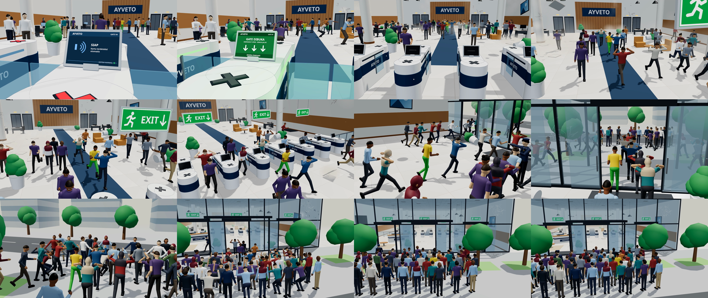

# AYVETO Emergency Evacuation – 3D Animations

Two 24 s, 1920×1080 (16:9), 30 fps H.264 videos of the AYVETO building, rendered deterministically with Three.js. In both, the gate system is off and all 7 gate lanes stand wide open.

## 1. Earthquake – [`ayveto_evakuasi_gempa.mp4`](ayveto_evakuasi_gempa.mp4) (with sound)

The video opens on a close-up of the gate's status display (SIAP, system normal). When the earthquake hits, the gate system detects it: every display flashes **GEMPA TERDETEKSI** with a live seismograph, the lane lights flash red and an alarm beeps. It then performs an emergency release (**GATE DIBUKA**, all 7 lanes' flaps swing open, green lights) and shuts itself down; the displays and lights go dark and the flaps stay open. The camera pulls back to the office behind the gates. The building shakes (camera shake from the ground motion), pendant lamps and hanging EXIT signs swing, lights flicker and then the power fails. Ceiling tiles fall with dust, plants and monitors topple, paintings drop off the wall, chairs roll, and the walls and glass facade crack.

Most people drop and cover their heads; the rest brace and look up. When the main shock eases, everyone, including the visitor in the yellow shirt, runs out through all the open gate lanes, across the lobby and through three entrance doors to the open area outside. The guard takes cover too, then waves people out and leaves last. An aftershock shatters a facade panel while people crouch outside.

The sound track is synthesised and in sync with the shaking: rumble, rattling, creaking, impacts and breaking glass. There are no voices.



## 2. Fire – [`ayveto_evakuasi_kebakaran.mp4`](ayveto_evakuasi_kebakaran.mp4) (no sound)

A fire breaks out in the office: smoke, alarm strobes, EXIT signs and an EVAKUASI screen. About 45 people walk out through all the open gates to the TITIK KUMPUL assembly point. The guard waves them through the doors.


The original access-process video (`ayveto_access_process.mp4`) is still in the repository; its source is in the git history.

## Files

| File | Purpose |
| --- | --- |
| `scene_gempa.js`, `quake.mjs`, `crowd_gempa.mjs`, `audio_gempa.mjs` | Earthquake scene, shared shaking timeline, crowd simulation, sound synthesis |
| `scene.js`, `crowd.mjs` | Fire scene and its crowd simulation |
| `render.mjs`, `index.html` | Frame-by-frame renderer (headless Chromium + ffmpeg) |

## Re-rendering

```bash
npm install
npx playwright install chromium
# earthquake
node render.mjs --scene scene_gempa          # -> ayveto_evakuasi_gempa_video.mp4 (no sound)
node audio_gempa.mjs gempa_audio.wav
ffmpeg -i ayveto_evakuasi_gempa_video.mp4 -i gempa_audio.wav -c:v copy -c:a aac -b:a 192k -shortest ayveto_evakuasi_gempa.mp4
# fire
node render.mjs                              # -> ayveto_evakuasi_kebakaran.mp4
# preview stills / free debug camera (x,y,z,targetX,targetY,targetZ)
node render.mjs --scene scene_gempa --stills 3,10,18 --cam 2.6,1.7,14.2,0.3,0.8,17
```
