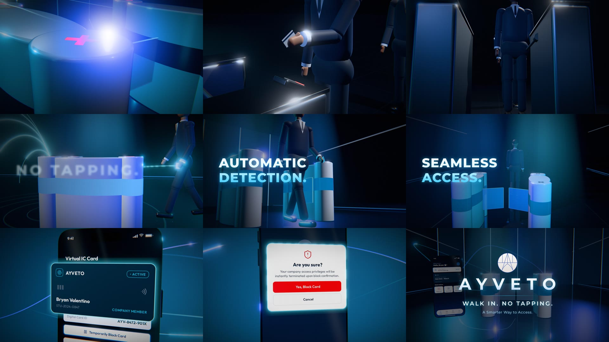

# AYVETO – 30 s Promotional Video

[`AYVETO_Promo_30s_1080p.mp4`](AYVETO_Promo_30s_1080p.mp4): 30.0 s, 1920×1080 (16:9), 24 fps, H.264 with AAC stereo audio. No voice-over.



## Scenes

| Time | Scene | On-screen text |
| --- | --- | --- |
| 0–4 s | Darkness, bass impact, blue light streaks reveal the AYVETO gate, digital scan, push-in | ACCESS. REIMAGINED. |
| 4–8 s | An office worker stops at a conventional gate to tap a card (reader blinks red, then green) while a queue forms | WHY STOP TO TAP? |
| 8–15 s | Energy sweep into the AYVETO gate. The same worker walks through holding the card: detection waves, X marks go dark, glass flaps open, he never stops | NO TAPPING. / AUTOMATIC DETECTION. / SEAMLESS ACCESS. |
| 15–22 s | Floating phone with the real app screens: Home (Tapless Detection, Notifications), Virtual IC Card, Report Lost Card + confirmation, Access History, Profile | SMARTER ACCESS. / MORE CONTROL. |
| 22–30 s | Gate and phone together, joined by energy lines, final impact, logo reveal, fade to black | AYVETO / WALK IN. NO TAPPING. / A Smarter Way to Access. |

- **Gate:** rebuilt from the Tinkercad prototype (two white units with a navy band, red X marks on top, glass flaps).
- **Character:** the yellow-shirt figure is replaced by an office worker in a navy blazer, white shirt, dark tie, charcoal trousers and black shoes.
- **App:** screens recreated 1:1 from the Figma prototype in `ui/app.template.html`. The login screen is not used because it says "university portal".
- **Sound:** original, synthesized in `audio.py` (bass impacts, scans, whooshes, gate servo and clank, 120 BPM electronic track).

## Files

| File | Purpose |
| --- | --- |
| `ui/app.template.html`, `build_ui.mjs` | App screens and their export to PNG textures (`assets/ui/`) |
| `scene/main.js` | Timeline, cameras, lighting, post-processing |
| `scene/builders.js` | Gate, conventional gate, character, phone, light trails |
| `scene/overlay.js` | Kinetic typography and logo reveal |
| `render.mjs`, `server.mjs` | Frame renderer (headless Chromium, parallel workers) |
| `audio.py`, `soundtrack.wav` | Soundtrack synthesis and output |

## Re-rendering

```bash
cd promo-30s
npm install && npx playwright install chromium
python -m venv .venv && .venv/bin/pip install numpy scipy imageio-ffmpeg
node build_ui.mjs                                            # app screens -> assets/ui/
node render.mjs --out frames --workers 6 --from 0 --to 720   # 720 PNG frames (resumable)
.venv/bin/python audio.py                                    # -> soundtrack.wav
ffmpeg -framerate 24 -i frames/f_%05d.png -i soundtrack.wav -c:v libx264 -crf 18 -pix_fmt yuv420p \
  -c:a aac -b:a 320k -t 30 -movflags +faststart AYVETO_Promo_30s_1080p.mp4
```

Add `--dpr 2` to `render.mjs` for a 3840×2160 (4K) render.
